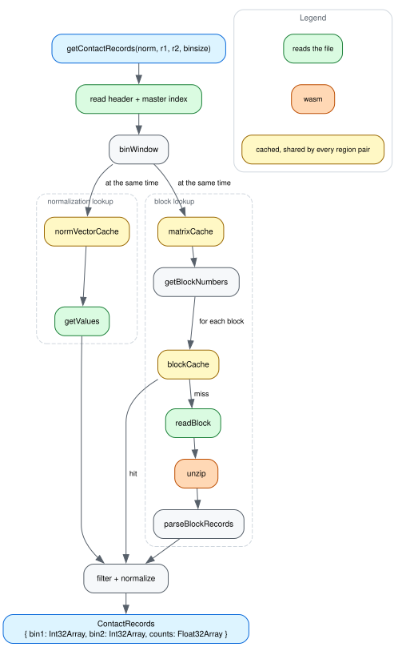

# How a fetch flows

A `.hic` file records how often two genome stretches touch inside the
nucleus. A fetch returns, for two regions at one resolution, how many contacts
join each pair of positions.

## The words on the diagram

- **Bin** — a fixed-width window (the `binsize`: 2.5 Mb, 100 kb, 5 kb) a
  contact is filed under by its two ends, not its exact coordinates. A file
  stores several binsizes as zoom levels; indices count from chromosome
  start, so bin 40 at 2.5 Mb begins at 100 Mb.
- **Matrix** — one per chromosome pair, with axes bin1 and bin2. Only
  `bin1 <= bin2` is stored, so a query arriving the other way round comes
  back `transposed`.
- **Block** — a matrix zoom level tiled into compressed, indexed squares, so
  a viewport reads only the tiles it overlaps.
- **Vector** — a one-dimensional per-bin correction (coverage, mappability,
  sequence composition) along one chromosome. Without the correction, a
  well-covered bin shows as a bright stripe across the matrix. Normalized
  count = raw count / (`v1[bin1] * v2[bin2]`). `KR`, `VC`, `SCALE` are
  different normalization methods; a file may contain several, or none.

## The path

[dataflow.dot](img/dataflow.dot) is the source; see
[CONTRIBUTING.md](../CONTRIBUTING.md) to re-render it. Each node is labeled
with the code that runs that step.

`getContactRecords` parses the header once, turns the regions into bin
windows, then runs the normalization-vector lookup and the block lookup
concurrently. A filter combines the two results, keeping in-window contacts and
dividing each by both normalization values.

The diagram leaves out the pre-v9 norm-vector-index walk,
`parseBlockRecords`'s three block encodings, and per-version field-width
differences. `NONE` skips normalization and returns raw counts.

## Why the path forks

Each lookup depends only on its own inputs, so a fetch runs the two
concurrently, sending the reads for a pair's missing vectors and blocks
together in one `Promise.all`. The fork is per region pair, and a caller
usually issues many pairs at once; a whole-genome human view has 24 regions and
300 pairs, all concurrent. See [optimizations.md](optimizations.md) for what that saves in
round trips.

## Why so much of it is yellow

Yellow nodes mark the steps a fetch's pairs share. The parser fetches a
chromosome's normalization vector once regardless of pair count, and a
chromosome pair's matrix once regardless of block count. The caching strategy
behind that, and its numbers, are in
[optimizations.md](optimizations.md#caches-sized-to-the-region-pair-working-set).

`normVectorCache` holds the parsed vector itself, so a cache hit still asks the
vector for the region's slice. That slice is usually already in the
±1000-value cache inside `NormalizationVector`, since pairs sharing a vector
ask for the same slice.

## Why a whole-genome view is affordable

- Coarser zoom levels are pre-binned in the file. At the coarsest zoom level,
  2.5 Mb, hg19 has ~1,240 bins per axis and ~800,000 mostly empty half-matrix
  cells, against 620,000 bins per axis at 5 kb.
- The blocks are indexed, so the parser reads only the tiles a pair's bin
  square touches. Many files have no inter-chromosomal matrices at all, so
  those pairs cost one lookup and nothing else.
- The 300 pairs of 24 regions share 24 normalization vectors. A whole-genome fetch of `test/data/test.hic` makes 648 range reads
  cold and 0 on repeat.

Contacts come back as three parallel typed arrays — `bin1`, `bin2`,
`counts` — each sized to the record count
([optimizations.md](optimizations.md#contacts-are-struct-of-arrays)).

## Where decompression sits

Decompression is the one CPU-bound step, drawn in the wasm-orange that the
sibling parsers' diagrams also use. What it costs, and why wasm over pako or `DecompressionStream`, is in
[optimizations.md](optimizations.md#inflate-is-wasm-libdeflate).

Every step here is thread-agnostic, so a caller who wants the work off the
main thread can run the whole read path inside a worker of its own.
